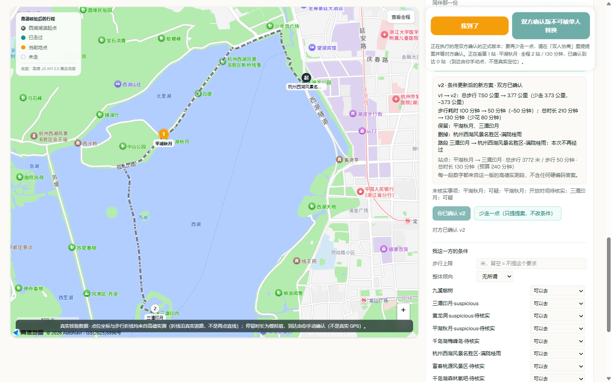
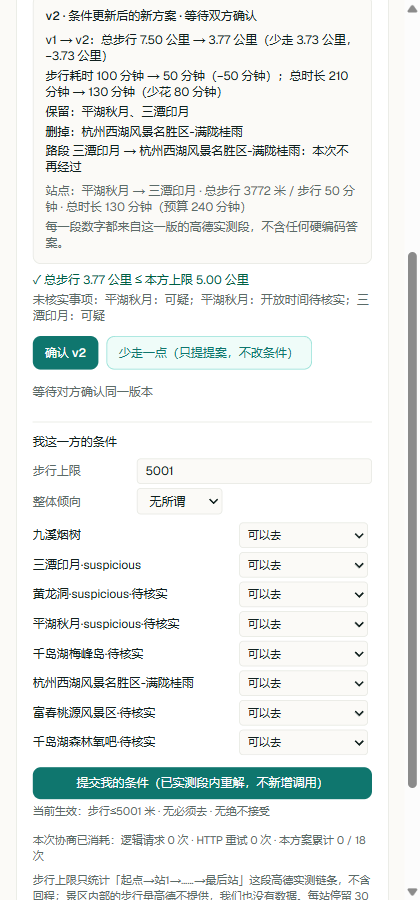

# 徐霞客 AI · 旅行搭子协商助手

**让一次「我不接受」，变成一份双方确认的真实行程。**

两个已经约好一起去杭州、却还不熟悉彼此旅行节奏的人：一个想多探索几个景点，另一个不愿走太多路。
徐霞客 AI 让双方分别填写条件，用飞猪真实地点和高德步行路径比较取舍，再由两个人分别确认同一版本。

**未竟工作室 · 2026 飞猪 AI 旅行创新大赛参赛项目**

[参赛介绍与投稿正文](docs/SUBMISSION.md) · [两分钟演示与操作手册](docs/DEMO.md) ·
[开场白与评委答辩](docs/PITCH.md) · [能力与证据索引](docs/EVIDENCE.md) · [部署说明](docs/DEPLOYMENT.md) · [MIT License](LICENSE)

## 一次真实取舍，改变了什么

以下为 2026-10-22 留存的运行案例：同伴把步行上限设为约 5 公里（本次输入 **5001 米**），系统比较已有实测路段，
保留平湖秋月、三潭印月，删去满陇桂雨，形成等待双方确认的新版本。

| 指标 | 原方案 | 新方案 |
| --- | --- | --- |
| 高德规划步行距离 | 7.50 公里 | 3.77 公里 |
| 高德预计步行耗时 | 100 分钟 | 50 分钟 |
| 含设定停留与缓冲的总时长 | 210 分钟 | 130 分钟 |



<details>
<summary>查看同伴条件更新后的完整差异截图</summary>



</details>

这是一次运行记录，不保证下一次查询返回相同站点或数字。截图保留当时界面，候选状态中的旧英文标签后来已修改，尚未重拍。
高德耗时是路径规划预计值，不是人实地走完的计时；每站停留 30 分钟和缓冲 20 分钟是产品设定。

## 三个核心机制

1. **每个人的条件进入路线选择。** 双方的步行上限、必须去与不能接受的地点参与候选和组合求解；愿意跟随不覆盖个人硬条件。
2. **每次取舍都有前后对比。** 展示距离、时间、保留与删去的景点、变化的路段，以及未入选或尚未核验的原因。
3. **每次同意都有具体对象。** 确认绑定行程版本与内容指纹。硬条件改变先挂起旧确认；普通改线提案在双方确认前不替换原正式版。

飞猪负责候选地点，高德提供地点及真实路径数据，服务端规则判定可行性，百炼负责讲解、解释和受约束的建议。
双人百炼解释接口已实现，**真实解释回合仍待实测**；已有单人讲解、路线调整的真实证据。各项状态见[证据索引](docs/EVIDENCE.md)。

- 技术栈：Next.js 16（App Router，Turbopack）· React 19 · Tailwind v4 · TypeScript
- 范围：只有杭州、只有半日（240 分钟预算）、只做目的地探索。没有酒店比价，没有全国城市，没有评分体系。

## 数据从哪来（界面上同样用这三类标签标出）

| 内容 | 来源 | 性质 |
| --- | --- | --- |
| 候选地点（名称、地址、飞猪链接） | 飞猪 FlyAI CLI，服务端 spawn `search-poi` | 真实调用 |
| 坐标、营业时间、POI 名称匹配、步行距离／时长／道路折线 | 高德 Web 服务 2.0（POI 搜索 + 步行路径规划） | 真实调用 |
| 每站停留 30 分钟、缓冲 20 分钟、240 分钟预算、假定出发时间 | 产品设定 | 模拟，界面明确标注 |
| 「已到达」 | 用户手动点击 | 模拟到达，**不是真实 GPS** |
| 现场讲解、「少走一点」想删哪些站 | 阿里云百炼 Managed Agent | 真实调用，输出经服务端复验 |

飞猪与高德都不提供「在一个景点该待多久」，所以停留时间只能是设定值——这条在所有界面文案里都写明了，
没有假装它是实测数据。

## 三层互不信任的校验

1. **坐标系是实测判定的，不是假设的。** 用若干双方同名的地标，分别按 GCJ-02 与 WGS-84 换算后与高德坐标比对，
   偏差更小的那套才算飞猪用的坐标系；证据不足时直接说「未能判定」。
2. **飞猪候选要和高德 POI 对得上。** 按名称与距离匹配，偏差超过 200 米标「坐标可疑」，匹配不上的进不了路线；
   候选凑不满 4 站时报「候选不足」，不会拿假地点凑数。
3. **智能体的每个数字都要对账。** 回复里出现的「米／分钟」逐条与高德实测值比对（合计值也计入未匹配并提示人工确认）；
   「少走一点」提出的方案必须由服务端**重新逐段实测**才允许上图，前端只展示通过复验的结果。

## 两个人一起用：双人协商

一句话定位：**让一次「我不接受」，变成一份双方确认的真实行程。**

A 先跑出一条真实路线，把「同伴那一份」链接发给 B。B 不需要账号，也不需要看到 A 的凭据——
链接本身就是这一方的访问凭据。B 说「我不想走这么多」之后，系统不会替谁放宽条件，而是：

1. 把 B 的硬条件**先落账并挂起旧确认**（这一步之后，超限的旧路线当场不能再用）；
2. 在**仍有效且覆盖所需有向路段的高德事实集**上重新求解；这些路段已经齐备时，重排、删站、换站可本地计算，不新增高德调用；
3. 给出带正负号的差异：总步行、步行耗时、总时长、站点集合与逐段增减；路段数字来自高德，总时长另含设定停留与缓冲；
4. 让 A、B **分别**确认同一个版本。只有一方确认、或确认的不是同一版，都不算正式生效；
5. 双方确认之后，地图、行程面板、「我到了」与百炼上下文一起切到这一版；此时单人的「少走一点」
   会被禁用——两个人的结论不能被一个人当场替换，要再少走只能在协商面板里提提案、等对方确认。

如果已实测的组合里没有任何一条同时满足两人的硬条件，界面直接说「需要双方协商」并给出证据
（哪一方、哪一条、差多少），不会悄悄放宽，也不会把「没测过」说成「走不到」。需要补测才能回答的条件，
系统根据去重后的缺边决定补测；**超过建议阈值 6 条时等待成本批准，1～6 条缺边仍可能直接补测**。
单轮 9 条、单方案 18 条和本小时余量三道硬上限在补测前检查。因此不能把所有协商修改都称为「零新增调用」。

### 百炼在这里做什么

`POST /api/plan/<id>/explain`（界面上的「让 AI 解释这次取舍」）把服务端已经算好的一切交给模型：
双方各自的硬条件与偏好、当前版本与状态、判定结论与矛盾证据、有符号差异、这一版的逐段实测、
服务端另外排出的可行走法、没进这一版的站与原因、还缺哪些实测段与补测上限。模型只做两件事：
**解释这次取舍**、**在服务端给出的下一步选项里挑**。

边界是硬的：距离、耗时、可行性、硬约束是否满足全部由服务端判定；模型不能改任何人的底线，
不能替对方同意（下一步选项的文案与报价由服务端按 key 回填，模型编出来的 key 会被丢弃并如实列出），
也不能编数字——它写出的每个「米／分钟」都要在事实块里出现，否则当场标为未匹配。
百炼失败时界面显示真实错误并保留规则求解结果，**不会拿固定文案冒充 AI 返回**。

> 这条链路目前的状态：事实块构造、角色隔离、失败如实、门禁拒绝都用夹具与 fetch 桩验证过（零付费）；
> **一次真实百炼回合的解释输出尚未实测**，实测完成前不宣称这项能力已经跑通。

### 数据的边界（双人模式同样成立）

步行上限只统计「起点→站1→……→最后站」这段高德实测链条，不含回程；景区内部的步行量高德不提供，
我们也没有数据。每站停留 30 分钟是模拟值、全程余量 20 分钟是产品设定，两者都不是实测。
飞猪与高德都没有返回门票价格，本项目没有任何来自数据的门票／价格字段，因此不构成预算保证。
营业时间只按假定出发时间判定冲突，不是完整开放时间的保证。这段口径在界面上原文出现，也原样进入给模型的事实块。

## 快速开始

需要 Node.js（`package.json` 要求 ≥20.9.0）与 npm；历史验收环境为 **Node 24.20.0**。
离线套件直接加载 `.ts` 源码，复现这批测试建议使用留存日志中的 Node 版本。FlyAI CLI 已列为项目依赖，无需全局安装。
服务凭据与百炼托管智能体需要自行准备，仓库不提供公共凭据。公开体验地址仍在准备中。

Windows PowerShell：

```powershell
npm ci
if (!(Test-Path -LiteralPath .env.local)) { Copy-Item -LiteralPath .env.example -Destination .env.local }
# 首次运行时填写 .env.local 的 8 项服务配置；已有配置不会被覆盖
npm run dev                                               # http://localhost:3000
```

macOS / Linux（Bash）：

```bash
npm ci
cp -n .env.example .env.local # 首次运行，再填写 8 项服务配置
npm run dev                  # http://localhost:3000
```

已有 `.env.local` 时跳过复制步骤，保留自己的配置。比赛演示使用 `npm run build`，成功后再运行 `npm start`。
双人体验：生成路线 → 发起双人协商 → 在另一浏览器打开 B 链接 → 分别提交条件 → 查看差异 → 双方确认同一版本。
角色链接是访问凭据，不要贴到公开 Issue、录屏或截图里。

打开页面后点那枚一直钉在屏幕上的「生成我的路线」（手机端贴在屏幕底部、桌面端贴在右栏顶部），服务端会按你在
「发现景点」里勾选的类别取飞猪候选，真实请求高德约 36 次（单类）～62 次（双类）（POI 搜索 + 步行路径规划），
挑出四小时内走得完的一条；出路线之后同一个位置换成「我到了／少走一点」。
刷新页面会在本标签页里原样恢复这条路线与已生成的讲解，不会重新消耗调用。

### 环境变量（全部只在服务端读取，没有任何 `NEXT_PUBLIC_*`）

| 变量 | 用途 |
| --- | --- |
| `FLYAI_API_KEY` | 飞猪 FlyAI CLI 的凭证，spawn 子进程时显式注入 |
| `AMAP_WEB_KEY` | 高德「Web 服务」Key，服务端调用 restapi |
| `AMAP_JS_KEY` | 高德「Web 端 (JS API)」Key，浏览器加载底图用，**必须与上面分开申请** |
| `AMAP_JS_SECURITY_CODE` | 高德 JS 安全密钥（jscode），只在服务端代理里补进请求，浏览器拿不到 |
| `DASHSCOPE_API_KEY` | 百炼工作空间 Key |
| `BAILIAN_WORKSPACE_ID` | 百炼工作空间 id（决定 API 宿主域名） |
| `BAILIAN_AGENT_ID` | 百炼托管智能体 id |
| `BAILIAN_ENV_ID` | 百炼运行环境 id |

用 Web 服务 Key 冒充 JS Key 会得到 `USERKEY_PLAT_NOMATCH`，此时地图退回手绘示意底图并明确标注「演示模式」，
不会画伪造的真实路线。

另有三个可选项，都不是凭据：`BAILIAN_REGION`（默认 `cn-beijing`）、`FLYAI_CLI_ROOT`（CLI 装在全局时才需要）、
`PLAN_SNAPSHOT_FILE`（双人协商快照位置，默认 `<项目>/.data/plan-snapshot.json`，那个目录必须可写且已被 gitignore）。

## 端点与花费防护

每个会真实花钱的端点都有小时上限、缓存与串行限流；上限命中时**直接拒绝并说明原因**，不降级成 Mock。

| 端点 | 真实外部调用 | 上限与缓存 |
| --- | --- | --- |
| `POST /api/verify` | 高德 POI 搜索 + 步行路径规划（单类实测约 36 次、双类约 62 次） | POI 40 次/小时、步行 80 次/小时；单条结果 6 秒→6 小时递增缓存；整条流水线结果缓存 30 分钟；串行发起（个人 Key 每秒只扛 2~3 次） |
| `GET/POST /api/discover` | 飞猪 CLI 子进程 | 12 次/小时；每个类别结果缓存 10 分钟；一次最多 2 个类别，串行 |
| `POST /api/agent` | 百炼托管智能体回合 | 40 回合/小时（超限连会话都不建）；回合超时 90 秒；会话 30 分钟 TTL；同票据同意图只允许一个回合在飞 |
| `POST /api/route-geometry` | 高德步行路径规划（补画折线） | 与 verify 共用步行上限；一次最多 8 段 |
| `POST /api/plan` | 无（复用已核验事实层） | 需要 factsId；事实层失效时返回 410 并说明重新核验约 36 次高德，不自动重跑 |
| `POST /api/plan/<id>/conditions`、`/propose` | 所需路段齐备时本地重解；缺边可能补测高德 | 单轮 9 段、单方案 18 段、本小时步行余量三道硬上限在花钱前判定；超过建议阈值 6 段等待成本批准，较少缺边仍可能直接补测；CAS 版本检查在花钱之前；每方案 40 次写入/小时 |
| `POST /api/plan/<id>/confirm`、`/revoke` | 无 | 确认只认当前版本 + 内容指纹；撤销只有 A 能做，两条链接同时失效 |
| `POST /api/plan/<id>/explain` | 百炼托管智能体 1 个回合 | 先验角色凭据，无方案/错凭据直接 410/401 且不建会话；受每方案写入上限与百炼 40 回合/小时双重约束 |
| `ANY /amap-proxy/[...path]` | 转发到高德，替浏览器补 jscode | 上游域名锁死 `restapi.amap.com` / `webapi.amap.com`；只放行 `v3/v4/v5` 前缀；路径字符白名单且拒绝 `..` 点段；`key` 必须等于本站 JS Key；只接受 GET/POST 且请求体 ≤ 256 KB；240 次/分钟；12 秒超时 |
| `GET /_AMapService/:path*` | 同上（SDK 看到的官方一级路由） | 由 `next.config.ts` rewrite 到上一行那个 handler，**同一个函数、同一套守卫**；浏览器永远不会看到 `/amap-proxy` |

> 计数与缓存都是**进程内**的。这在单机常驻 Node 上语义完全成立，在 serverless 多实例下会变成
> 「每实例各算各的」——这正是选择部署方式时最要紧的一条，见 [docs/DEPLOYMENT.md](docs/DEPLOYMENT.md)。
>
> 例外是最小快照：协商方案、版本、确认与撤销状态会原子写入 `.data/plan-snapshot.json`（已 gitignore，
> 里面只有实测数据与令牌**哈希**），所以同机重启不再等于协商全部作废；恢复时有效期按**原始采集时间**算，
> 事实过期就是过期，端点如实报失效并报价，绝不借重启偷偷续期或重跑付费核验。

## 验收

先看[证据索引](docs/EVIDENCE.md)：**139 项夹具/桩检查 + 12 项本地端点守卫 = 151 项**，不代表 151 项真实端到端验收。
`npm run test:offline` 只运行前 139 项；守卫另需本地服务。下面列的是检查命令与预期覆盖数，不等于每个脚本都有完整通过日志。

纯离线套件（不需要启动服务）：

```bash
npm run test:offline
```

其他检查分开执行；启动服务后在另一个终端运行端点与浏览器脚本：

```bash
npm run build
npm start

# —— 零付费：夹具与本地文件，不产生任何外部调用 ——
npm run test:negotiation     # 四道门主干：求解／报价／配额／票据，68 项
npm run test:rules           # 状态规则边角：挂起不复活、过期不先花钱、相同内容也开新版，22 项
npm run test:plan-ai         # 双人事实块 + 角色隔离 + 失败如实（fetch 桩，24 项）
npm run test:snapshot        # 最小快照：另起进程模拟重启，含损坏与过期，25 项
node evidence/plan-guard-probe.mjs        # 端点守门：401/410/413/不泄露内部路径，12 项

# —— 真实服务：会产生调用，跑之前先看清成本 ——
node evidence/plan-api-smoke.mjs          # 双人协商完整闭环（真实 HTTP），30 项
node evidence/phase9-accept.mjs           # 双人界面：两个浏览器上下文，含手机视口，30 项
node evidence/phase8-accept.mjs           # 现场演示稳定性：弹窗／刷新恢复／首屏／视口／收益数字，29 项
node evidence/phase6-accept.mjs           # 真实地图与同步链路，25 项（也可 npm run test:accept）
node evidence/phase8-copy-probe.mjs       # 只查文案与遮挡的收尾探针，全程 0 次 POST
```

线上复跑的环境变量写法：PowerShell 用 `$env:BASE_URL = 'https://你的域名'`，Bash 用 `export BASE_URL=https://你的域名`，
再运行相应脚本。真实浏览器脚本还需要现有可用的 Playwright 与 Chromium 环境；它们不是 `npm ci` 自动装好的项目依赖。
不要为确认文案而反复运行真实脚本，也不要假定多脚本必然命中同一缓存。

零付费那几组跑的是与构建产物同一份源码（`evidence/alias-hook.mjs` 只补路径解析，不改代码），
其中标「夹具」的数字**不代表任何真实能力**；真实路线与真实 AI 回合仍由上面「真实服务」那几组验收。
`plan-persistence.mjs` 与 `plan-ai.mjs` 都把 `globalThis.fetch` 换成会抛错的桩，任何一步想去碰高德／百炼都会当场失败，
所以这两组可以确定地宣称「零调用」，而不是「看起来没调用」。

`phase8-accept.mjs` 专跑比赛现场最容易翻车的五件事：SDK 首次加载**没有任何阻塞弹窗**（浏览器只打官方一级路由
`/_AMapService`，`/amap-proxy` 一次都不出现）、刷新页面后行程／讲解／到达记录原样回来且服务端计数**一格没涨**
（恢复来自本标签页 sessionStorage，不是重跑核验，也不是再买一个百炼回合）、「生成我的路线」在 390×844 首屏内、
桌面切手机后所有站点重新回到底图内并且「查看全程」能拉回全览、以及「少走一点」显示的「总行程缩短」等于界面前后
两份高德实测行程之差。
`phase8-copy-probe.mjs` 是改文案时用的零调用探针：确认屏幕上不再出现「左侧地图／上方行程」这类只在桌面布局成立的
指向词，并确认手机端滚到底时最后一段内容没有被钉住的按钮条压住。
脚本驱动一个**真实可见**的 Chromium 窗口，用真实鼠标事件跑完清单：底图是否真的渲染（canvas 数、只有一个地图实例，
再用容器截图的字节数确认瓦片画满了内容而不是一片空白网格）、地图标记数是否等于当前路线的卡片数 + 起点、
顶栏口径是否跟着当前生效路线走、阶段一演示行程是否已从主界面撤下（并且仍能在调试面板里展开看到）、
折线每段点数（证明沿真实道路而不是两点直线）、卡片点选后地图中心与实测坐标的偏差（0 米）、双击／工具栏／滚轮／拖拽
是否生效、手势全程有没有偷偷调用百炼或高德、到达后走过的路段是否变实线、「少走一点」后地图是否同步删除旧站点、
标记 DOM 数与覆盖物数是否一致、手机端层级与首屏、以及浏览器 DOM 里是否存在任何密钥。
逐项结果与截图在 [evidence/](evidence/) 目录；`phase8-accept.log` 留存了该批 29/29 通过的结果。
双人关键画面已有截图，但 `plan-api-smoke.log` 仍是 20/26 的历史失败记录，后续完整通过的独立日志待补，不据此宣称「所有真实验收已通过」。
最近一次**零付费全量**（151 项）的独立成功日志在
[evidence/offline-accept-2026-10-22.log](evidence/offline-accept-2026-10-22.log)，里面写清了代码版本、
测试时间、哪些数字来自夹具、以及本轮真实新增调用量＝0；失败历史留在各自原来的时间戳文件里，不混写。
演示台词、固定演示案例、电脑＋手机手工核对清单、视频分镜与待确认清单，写在 [docs/DEMO.md](docs/DEMO.md)。

## 安全

- 密钥只存在于 `.env.local` 或部署平台的环境变量里；`.gitignore` 忽略 `.env*`，只提交 `.env.example`。
- 所有对外日志与「调用凭证」只输出脱敏形状（例如 `sk-1E2****3co`），CLI 路径以 `node_modules/…` 相对形式展示，
  不带本机用户名；页面与 API 响应里都没有裸会话对象。
- 子进程环境变量按白名单下发：飞猪 CLI 只拿到 `FLYAI_API_KEY` 与运行必需的几项，拿不到高德和百炼的凭据。
- 浏览器唯一能看到的密钥是高德 JS Key——它本来就是「Web 端」类型、必须交给浏览器加载 SDK，
  且只出现在 `webapi.amap.com` 的 script 地址里，验收脚本会检查它没有落进页面文本。
- ⚠️ **高德 JS 凭据（JS API Key 与安全密钥）在开发过程中曾整串贴进对话，按已泄露处理。** 2026-10-22 已换新一对
  并实测能画出真实底图（`node evidence/jskey-rotation-probe.mjs`）。**泄露的是旧 Key，它明天（2026-10-23）才能删除**
  ——高德对有流量的 Key 有 24 小时限制，删掉之前那个值仍然可用，这是当前唯一真正的泄露面；新 Key 没上过公网。
  域名白名单在本地/局域网阶段填不进去（实测 `localhost` 与 IP 会被弹「有不符合规范的域名」），JS 端 Key 也没有
  每日配额入口，所以这两道闸要等到公开部署有真实域名那天再落。在那之前，本项目不宣称密钥安全问题已经解决。
  逐项状态与原因写在 [docs/SECURITY.md](docs/SECURITY.md) 第 2 节。

## 目录

```
src/app/            页面与 API 路由（含 /amap-proxy 安全代理）
src/components/     界面面板；技术日志与原始 JSON 全在 DebugPanel（默认折叠）
src/hooks/          前端状态：发现、核验、智能体回合、地图配置、折线补查
src/lib/            类型、格式化、来源标签、回复对账
src/lib/negotiation/ 双人协商的纯函数层：事实集、求解、有符号差异、状态机与执行门禁、给模型的事实块
src/lib/server/     服务端：飞猪 CLI、高德、核验流水线、百炼会话与回合、JS 代理、协商方案与快照落盘
scripts/            一次性探针脚本（都从环境变量读凭据，输出脱敏）
evidence/           验收套件、逐项结果与截图
docs/               演示与验收手册（DEMO.md）、安全检查（SECURITY.md）、部署兼容性（DEPLOYMENT.md）
```

上线前安全检查的逐项结论（凭据边界、代理白名单、端点滥用面、尚未做的事）写在 [docs/SECURITY.md](docs/SECURITY.md)；
架构、部署兼容性与平台选择的完整判断写在 [docs/DEPLOYMENT.md](docs/DEPLOYMENT.md)。

## 授权

代码以 [MIT License](LICENSE) 发布。两点边界说清楚，免得被误读：

- MIT 管的只是**本仓库里的代码与文档**。飞猪 FlyAI、高德开放平台、阿里云百炼各自的**服务条款与数据条款不受影响**——
  包括 Key 的使用方式、配额，以及能否把它们返回的数据再分发。要商用请先去读那三份协议。
- 本仓库**不包含任何凭据**。跑起来需要你自己准备 `.env.local`（变量清单见上面「环境变量」一节，只有 `.env.example` 入库）。
  仓库里的 `evidence/` 同时包含真实服务记录、历史失败、夹具与 fetch 桩结果；按各文件标记理解，不能把夹具数字当作真实路线或模型输出。
