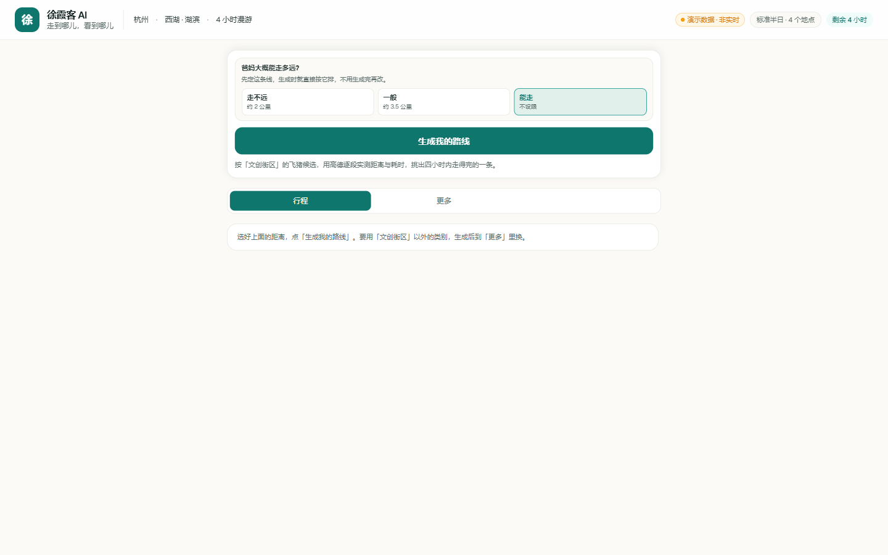
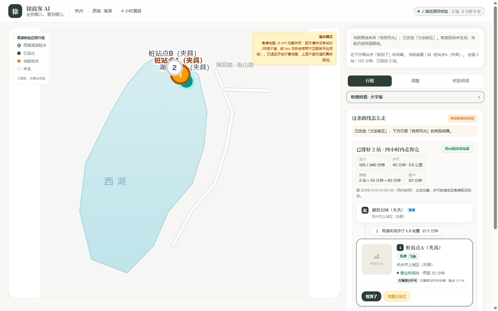
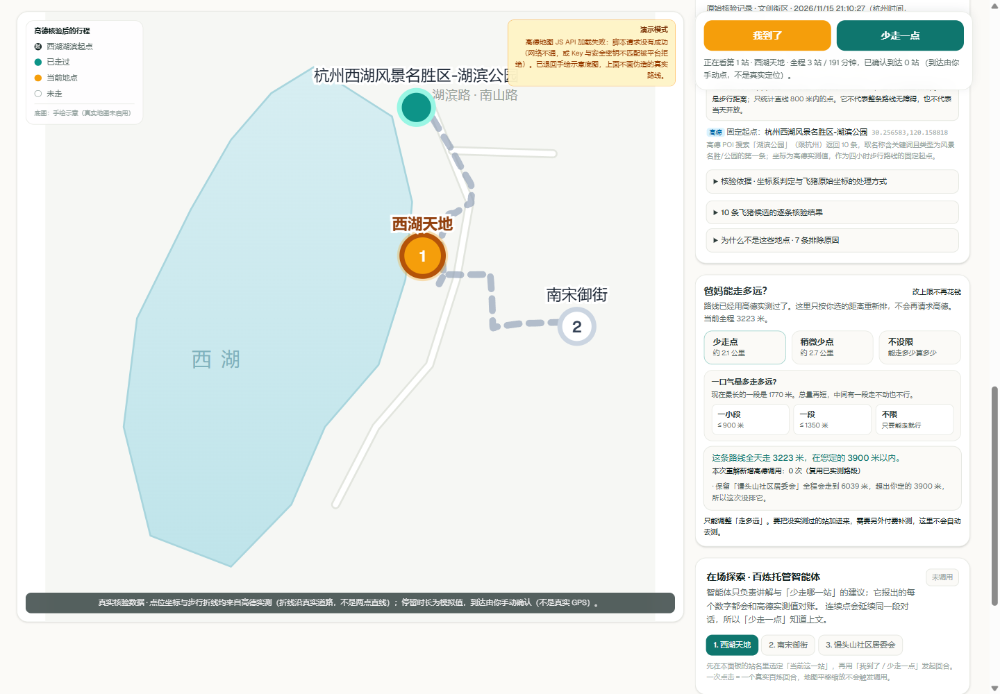
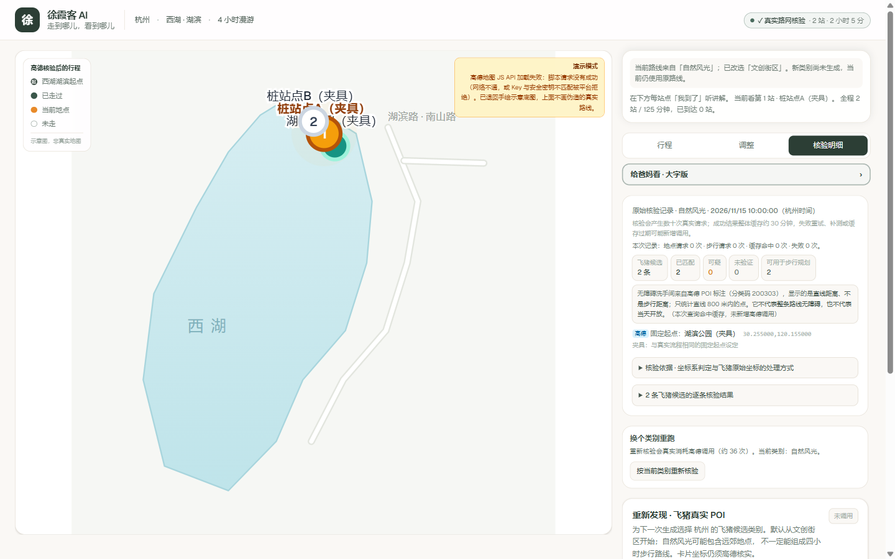
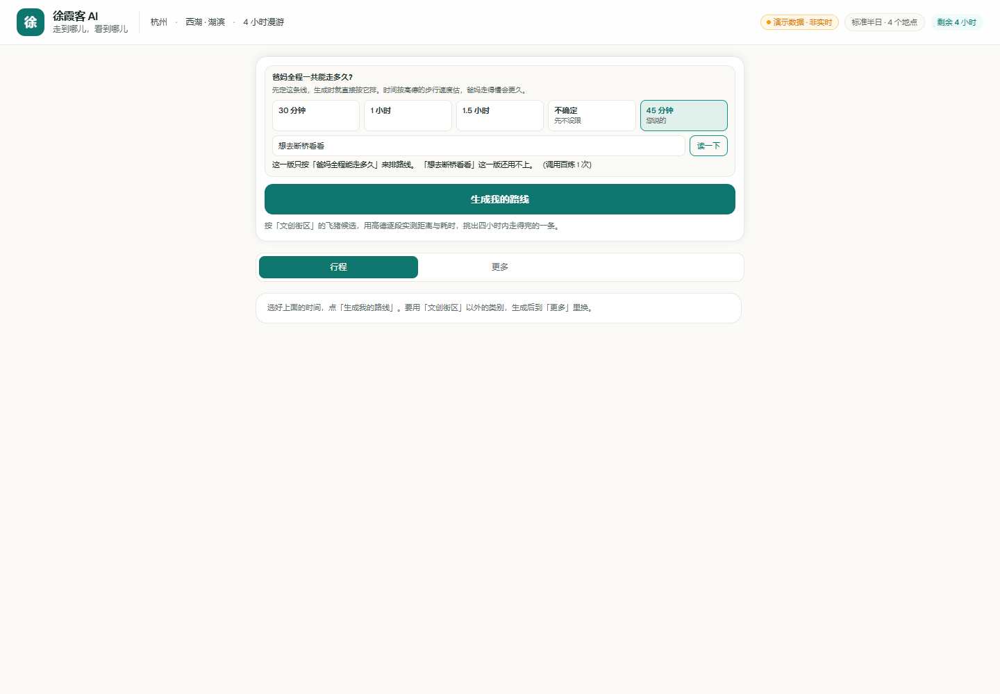

# 参赛投稿正文

团队：未竟工作室。下方按官方 GitHub Issue 模板组织，正文从「参赛项目名称」开始复制。

> **投稿前必须完成的动作**（否则正文与 Demo 不一致）：
> 1. 把 `feat/family-mode` 部署上线——线上现在跑的是旧版 `c906649`，不含本文描述的任何功能。
> 2. 或者把正文里的 Demo 链接换成「即将更新」，并说明当前线上是旧版。
> 3. 效果展示部分的截图来自本地最新构建（`e9aecd1`），需连同该说明一并提交。

---

## 参赛项目名称

**徐霞客 AI · 带爸妈出行的路线协商助手**

> 把「爸妈走不动」变成能算的条件，然后摊开给你看。

---

## 团队 / 作者与奖品领取人

- 团队名称：未竟工作室
- 主要提交人 GitHub ID（必填、唯一奖品领取人）：[@mckinstryhancher688-pixel](https://github.com/mckinstryhancher688-pixel)
- 其他成员：本次未登记其他署名

---

## 旅行场景与目标用户

**目标用户**：带父母或祖辈出游的成年子女。

**那个具体场景**：你带爸妈玩杭州，问「咱们再多逛一个地方吧」，他们说「行啊」。
然后走了两百米，开始找椅子。

这个矛盾**不是信息不够**。再生成一版攻略解决不了它——攻略告诉你「去哪」，不告诉你「这一趟到底要走多少米」。
真正的矛盾是：**想多逛的人和走不动的人，坐在同一张桌子上。**

**为什么是我们这个角度**：36 件参赛作品里，绝大多数在解决「怎么规划得更好」。
我们解决的是另一件事——**不同人的限制怎么同时成立**。
这个题不是靠更好的模型，是靠把限制变成可计算、可核对、可修改的东西。

**范围（刻意压窄，不贪）**：只有杭州、只有半日、只做目的地探索。
没有全国城市、没有酒店比价、没有评分体系。

---

## 我做了什么

### 一句话，变成一张能核对的卡

用户在首页说一句「带我妈去杭州，她膝盖不好，半天就行」。系统不直接给行程，先给一张卡：

```
我理解成这样，对吗？

☑ 爸妈全程能走约 90 分钟      ← 从「半天」算的
☐ 还需要问一句：走半小时就歇，还是全程？  ← 这句话算不出来，追问
```

**关键设计：数字不由模型给。**
模型只做两件事——判断这句话属于哪一类、写一句追问。
凡是出现的分钟数，都由代码从用户原话里逐字摘出来算；
摘不出原文就追问，**不猜、不换算**。

> 实测依据：40 条真实语句探针，硬性校验 40/40 通过，
> 模型判断与预期完全一致 34/40 —— 剩下 6 条正是靠代码兜底纠正的。
> 见 `evidence/understand-real-probe.json`

### 两个独立的步行约束，不是一个

大多数工具只有一个「总步行上限」。我们做了两个，因为它们解决不同问题：

| 约束 | 解决什么 |
|---|---|
| **全天总步行上限** | 一天下来别累垮 |
| **单段最长连续步行** | 总量够短，也可能中间有一段走不动 |

一条 4 公里的路线，如果有一段连着走 1.2 公里，对膝盖不好的人照样不行。
这两个条件各自独立生效，服务端按高德**逐段实测值**判断。

### 改条件不花钱

**这是整个项目最重要的一个数字。**

核验要花钱（真实高德调用）。但改主意不该再花钱。

核验时付费测过的每一段路都留在事实层里，之后改上限是**本地重解**：

> 真机验收：一次核验 27 次高德调用，之后连续三次改上限 —— **0 / 0 / 0**。
> 见 `evidence/solo-resolve-accept.json`

界面上直接写「本次重解新增高德调用：0 次（复用已实测路段）」——
这是我们自己的承诺，也由我们自己证明。

### 算不出来时，说清是哪条卡住的

不是丢一句「未找到可行路线」，而是：

> 按当前条件最多只能排 1 个站（集贤亭），少于半日游最少需要的 2 站。
> **取消单段上限后能排到 4 站，说明是「一口气最多走 400 米」把站点压掉了。**

用户因此知道该改哪个数字。

### 给爸妈看的大字版

同一个手机，点一下切到另一套界面：只讲去哪几个地方、走多久、厕所在哪。
字号 1.0–1.8 倍可调，最小 22px 实测。

去掉的东西：来源标签、正负号差异、技术证明。
保留的东西：诚实口径，用大白话写。

### 沿途无障碍洗手间

每站标出最近的高德标注无障碍洗手间与**直线距离**（半径 800 米内）。

**我们明确不做的事**：高德公开分类体系里只有「无障碍洗手间」这一个**点**（分类码 200303），
没有坡道、台阶、盲道、坡度的**路**数据。
所以我们**不承诺「整条路线轮椅可通行」**——验证不了的，我们不说。

---

## 百炼使用说明（必填）

### 在运行时链路的哪里

**只用在两处，都在产品运行时**，没有用在开发链路。

#### ① 读「说说爸妈的情况」那一句话 —— OpenAI 兼容接口

| 项 | 内容 |
|---|---|
| 调用方式 | **API 直连**：`https://{workspace}.cn-beijing.maas.aliyuncs.com/compatible-mode/v1/chat/completions` |
| 模型 | **`qwen-flash`**（默认关思考模式，非思考模式支持 json_object） |
| 强制格式 | `response_format: json_object`、`temperature: 0` |
| 输入 | 用户原话（≤200 字）+ 系统提示里的 7 条判断规则 |
| 输出 | `{ kind: "total" \| "ask" \| "off-topic", quote, question, other[] }` |
| 服务端复验 | `quote` 必须逐字出现在用户原文里，否则作废；`question` 里不许出现用户没提过的时长或距离，否则换成默认问题 |
| 失败处理 | 超时/报错/格式不合法 → 退回默认追问，**不拿固定文案冒充模型返回** |
| 成本控制 | 独立小时上限 60 次，超限直接拒绝、不发请求 |
| 隐私 | 用户原话只发给百炼，不写日志；日志只留时间、状态码、耗时、token 数 |

**为什么选直连而不是托管智能体**：这里只需要「分类 + 一句追问」，
托管智能体一回合要建会话、订阅 SSE、提交消息三次请求，也没法强制返回固定格式。

#### ② 到站讲解 / 解释取舍 —— 百炼托管智能体

| 项 | 内容 |
|---|---|
| 调用方式 | **Managed Agent HTTP API**：`https://{workspace}.{region}.maas.aliyuncs.com/api/v1/agentstudio`，`agent_with_overrides` |
| 会话 | 服务端管理会话，`disableTools: true`、会话级 system 注入常驻规则 |
| 输入 | 当前已核实路线、站点事实、高德实测的每段距离与耗时 |
| 输出 | 讲解文本；其中每个「米 / 分钟」都与服务端实测值逐条比对，对不上的当场标为未匹配 |
| 边界 | 模型**不能改任何人的硬条件**，**不能碰路线数字**，失败时如实展示错误并保留规则求解结果 |

### 其他技术栈

Next.js 16（App Router + Turbopack）· React 19 · TypeScript · Tailwind CSS v4
· 高德 Web 服务 v5（`place/text`、`direction/walking`）· 飞猪 FlyAI CLI（`search-poi`）
· 高德 JS API 2.0（地图展示）

### 三家的分工

| 服务 | 提供什么 | 我们的用法 |
|---|---|---|
| **飞猪 FlyAI** | 候选地点：名称、地址、坐标、飞猪链接、id | 核验第一步的候选池；每站 id 再代码复验一次真伪 |
| **高德 Web 服务** | POI 检索、逐段步行距离与折线、无障碍洗手间分类 | **所有判断的数字都来自这里** |
| **百炼** | 语言理解、讲解、解释 | 只翻译与解释，**不碰数字、不碰硬条件** |

---

## 效果展示

> 以下截图来自本地最新构建（`e9aecd1`），界面为亲情版。

### 1. 首页只有一件事：先问爸妈能走多久



### 2. 真实三站行程，卡片上没有任何工程标签

只留站名、飞猪链接、地址、停留时长、营业状态、无障碍洗手间距离，
以及每站内嵌的「我到了」。



### 3. 真实数据：6039 米，两个约束各自生效

西湖天地 / 南宋御街 / 馒头山社区居委会，全程 6039 米、最长一段 2816 米。



### 4. 给爸妈看的大字版


### 5. 核验明细单独一页

原始记录、候选统计、坐标系判定、排除原因全部归档，不再占首屏。



### 6. 一句话读条件（真实探针）



**演示视频暂无**，不填虚构链接。

---

## 项目链接与复现方式

- 仓库：[徐霞客 AI 源码仓库](https://github.com/mckinstryhancher688-pixel/xuxiake-ai-hangzhou)（MIT）
- Demo：`travel.peiqirui.com`
  - ⚠️ **当前线上是旧版（`c906649`），不含本文描述的亲情版功能**；新版在 `feat/family-mode` 分支待部署
- 运行与配置见仓库 README

**体验步骤**（部署新版后）：

1. 首页选「爸妈大概能走多久」，或直接说一句「带我妈去杭州，她膝盖不好」
2. 点「生成我的路线」——首次会真实调用飞猪与高德（约 36 次）
3. 到「调整」页改总步行或单段上限，观察行程变化与「本次新增高德调用：0 次」
4. 点「给爸妈看」切到大字版
5. 每站点「我到了」听百炼讲解

**成本提示**：首次核验是真实付费调用；之后在同一事实集上改条件免费。
「自然风光」类别近期会返回杭州周边几十公里外的景点导致排不出路线，
**演示建议用「文创街区」**。

---

## 商业闭环

**现状：未开通飞猪推广者，没有分佣。** 不虚构收入模型。

**为什么没做**：这一版的全部精力放在「限制能不能被诚实地算出来」上，
包括两个独立约束的求解、免费重解的事实层、以及模型不许碰数字的边界。
变现链路是另一件事，没有余力做，也不想用「即将上线」糊过去。

**如果继续做，闭环长这样**（按可行性排序）：

1. **飞猪推广者分佣**（最直接）
   行程里每个站点已经带真实飞猪链接与 id，只需把链接换成推广者接口生成的链接。
   **前提**：开通推广者资质。目前没有——这是我们与「开口泰」最明显的差距。
2. **按次付费的核验额度**（最贴合成本结构）
   核验一次是真实的高德调用成本，天然适合按次计费。
   我们已经把「改条件免费 / 补测收费」分得很清，计费口径现成。
3. **不做**：门票代订、酒店分销——我们没有价格数据，也不掌握库存。

**这一节的原则**：没做的写「没做」，不把「接口已接」写成「已经变现」。

---

## 踩坑记录（可选）

### 1. 模型天生会编数字，所以数字不能交给它

最初想让模型直接读「膝盖不好」然后给出「最多走 2 公里」。
后来发现这个数字最后会显示成「在您定的 2 公里以内」——
**但用户从没说过 2 公里，是我们编的**，而且这条路线会通过所有校验，看起来完全正当。

现在的做法：模型只做分类和追问，**任何数字都由代码从原话里逐字摘出来算**；
摘不出原文就追问，不猜。

### 2. 「走不动」不是一个条件，是两个

只限总量会漏掉「中间有一段连着走 1.2 公里」的情况。
单段上限必须独立判定——这是我们后来才补的。

### 3. 不能每改一次主意就重新查一遍地图

不然「妈说太远了，改一下」这个动作，每次都要花几十次调用。
把实测事实与路线求解分开之后，改条件才变成 0 成本。

### 4. 把点说成路，就是编造

高德只有「无障碍洗手间」这一个 POI 标注点，没有路面无障碍数据。
我们最初想写「无障碍路线」，查过分类表 2499 条之后放弃了——
**做不到的事必须写在界面上，不能等用户到现场才发现。**

### 5. 界面像控制台，是因为把所有工程信息都摆在了外面

第一版首屏有 16 个可点按钮、1851 个字。
用户原话：「我看了都想吐」。

现在 6 个按钮、354 字，工程信息全部归档到「核验明细」。
**不是删掉，是分层。**

### 6. 地图默认显示在首页，是个错误

没有产品会在首页放一张地图。地图应该跟着行程出现，不是当封面。

---

## 附：本文所引证据

| 结论 | 证据文件 |
|---|---|
| 改条件 0 新增调用 | `evidence/solo-resolve-accept.json` |
| 亲情版端到端 20/20 | `evidence/family-real-accept.json` |
| 一句话读条件 40 条真实探针 | `evidence/understand-real-probe.json` |
| 读条件界面 26/26 | `evidence/understand-ui.json` |
| 界面减负 33/33 | `evidence/ui-density-accept.json` |
| 大字版 23/23 | `evidence/elder-view-accept.json` |
| 无障碍洗手间可查 | `evidence/amap-accessibility-200303-2026-11-15.json` |
| 来源证据校验 | `evidence/source-evidence-paid-accept.json` |
