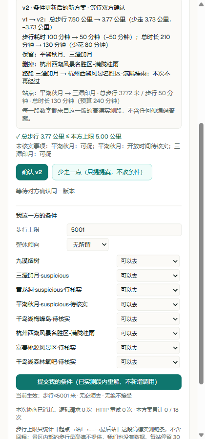
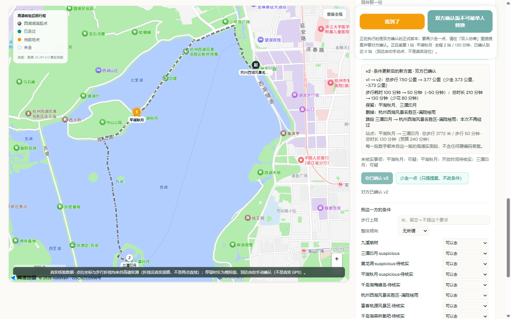

# 参赛投稿正文

团队：未竟工作室。下方按官方 GitHub Issue 模板组织，正文从「参赛项目名称」开始复制。
公开体验入口已于 2026-10-24 发布新修复版本，页面与快照恢复检查通过；真实新版本业务闭环尚待验收。演示视频暂无，不填虚构链接。
官方入口、截止时间和证据状态见 [EVIDENCE.md](EVIDENCE.md)。

## 投稿标题（填写到 Issue 标题栏）

【2026飞猪AI旅行创新大赛】徐霞客 AI｜让旅行搭子的分歧，变成双方确认的行程

以下正文在 2026-10-23 随可靠性修复更新。双人百炼解释仍保留当前公开版本披露的实测边界。

---

## 参赛项目名称

**徐霞客 AI · 旅行搭子协商助手**

> 让一次“我不接受”，变成一份双方确认的真实行程。

两个已经约好一起去杭州、却还不熟悉彼此旅行节奏的人：一个想多探索几个景点，另一个不愿走太多路。徐霞客 AI 让双方分别表达条件，基于飞猪真实地点和高德步行数据比较取舍，再由两个人分别确认同一版安排。

## 团队 / 作者与奖品领取人

- 团队名称：未竟工作室
- 主要提交人 GitHub ID（仅 1 位，必填）：[mckinstryhancher688-pixel](https://github.com/mckinstryhancher688-pixel)
- 其他成员（可选，仅用于署名）：本次未登记其他署名

## 旅行场景与目标用户

面向两个已经约好同行、目的地已经确定，但彼此还不熟悉的成年旅行搭子。

他们能约到同一个城市，却未必能接受同一条路线：有人想多逛，有人体力有限；有人特别想去一个景点，另一个人只是愿意陪同。直接生成一份攻略，常常把这些分歧留给人自己处理。

我们从**杭州半日出游**切入，让双方围绕具体地点、真实距离和可比较的路线沟通。愿意陪同不会覆盖个人硬条件；条件无法同时满足时，系统明确呈现冲突，保留双方拒绝和修改的权利。

## 我做了什么

### 一次具体取舍，看得见改变

仓库的一次实际运行中，初版路线为 **7.50 公里、步行 100 分钟**。同伴将步行上限设为 **约 5 公里（本次输入 5001 米）**后，重新求解得到 **3.77 公里、步行 50 分钟**的方案：保留“平湖秋月”和“三潭印月”，删去“满陇桂雨”，总行程从 **210 分钟变为 130 分钟**。

这些是该次运行的结果，不是对所有路线的承诺。步行距离与预计耗时来自高德路径规划，不是实地走测；总行程包含每站 30 分钟停留和 20 分钟缓冲的产品设定。

### 三个核心机制

1. **每个人的条件真正参与选路线。** 双方分别填写偏好与硬条件，系统据此筛选候选、比较组合。不能满足的条件会给出证据，不会替任何一方悄悄放宽。
2. **每次取舍有可核查的差异。** 展示前后距离、步行耗时、总时长、保留与删去的景点，以及发生变化的路段。已有有效实测路段可直接复用；缺边可能补测，超过 6 条时等待成本批准，另受单轮 9 条、单方案 18 条及小时余量限制。
3. **同意只对具体版本有效。** A、B 分别通过自己的角色链接操作。硬条件变化先挂起旧确认；普通路线提案在双方确认前不替换原正式版。只有双方确认同一版本与内容，地图和执行面板才切换到该方案。

当前版本补充了条件草稿保留、跨端状态同步、B 方正式行程清单与杭州时区一致性。正式地图只读已保存折线，缺失不补测；事实过期后暂停执行。258 个离线检查/场景与 17 项本地模拟交互已通过，真实服务证据与模拟证据分别列在[证据索引](EVIDENCE.md)。

### 从发现到协商，再到执行

飞猪 FlyAI 提供候选地点 → 高德核对地点身份与真实步行路径 → 双方表达条件并比较方案 → 双方分别确认 → 按正式版本展示地图和行程。

百炼在运行时提供现场讲解与受约束的减法建议；双人取舍解释也已实现接口，可用于协商过程，真实回合状态单独列在下节。

当前核心是两位搭子的半日安排。长期希望验证的价值是：减少同行前的反复沟通，让双方更容易判断“这条路线我是否接受”。用户留存、支付意愿和商业模式仍需后续验证。

## 百炼使用说明（必填）

- **百炼能力 / 模型：**阿里云百炼 Managed Agent（托管智能体）。底层模型以实际百炼部署配置为准，不将仓库没有固定公开的型号写成既成事实。
- **调用方式：**网站服务端通过百炼 Managed Agent HTTP API 管理会话并执行回合，属于产品运行时链路。
- **使用环节与输入输出：**
  - 现场讲解：输入当前已核验路线与站点事实，输出讲解文本。
  - “少走一点”：输入当前路线与事实，输出减法建议；服务端复核后才允许采用。
  - 双人“解释这次取舍”：接口已接入服务端事实块，包括双方条件、冲突证据、版本差异、实测路段、候选排除原因及允许的下一步；模型负责解释和提出受约束建议，不能改写硬条件、路线数字或代替用户确认。
- **当前实测状态：**已有单人讲解与路线调整的真实运行证据；新增双人解释链路的事实构造、角色隔离与失败处理已通过离线测试，公开版本仍标明“一次真实百炼解释回合尚未实测”，不将测试桩结果当作真实模型效果。
- **Skill 名称（如有）：**飞猪数据侧通过官方 FlyAI CLI 获取 POI，不将上游能力宣称为自研 Skill。
- **其他工具 / 技术栈：**Next.js 16、React 19、TypeScript、Tailwind CSS、高德地图 Web 服务及 JS 地图。

## 效果展示

### 1. 同伴表达步行上限，系统展示具体取舍

7.50 公里 → 3.77 公里；步行 100 分钟 → 50 分钟。界面同时说明保留、删去的景点和仍需核实的信息。
两图为 2026-10-22 留存的历史运行证据，候选状态中的旧英文标签后来已修改，尚未重拍；不将历史截图称为当前界面验收。

### 2. 双方确认同一版本后，地图与执行面板同步采用

更多运行截图与验收资料见仓库 [evidence 目录](https://github.com/mckinstryhancher688-pixel/xuxiake-ai-hangzhou/tree/3e129045659dd8c13ec92e66077ce92a4650c5c3/evidence)。

## 项目链接与复现方式

- GitHub：[徐霞客 AI 源码仓库](https://github.com/mckinstryhancher688-pixel/xuxiake-ai-hangzhou)
- 运行与配置：[README](https://github.com/mckinstryhancher688-pixel/xuxiake-ai-hangzhou/blob/main/README.md)
- 代码许可证：MIT。飞猪、高德、百炼服务与数据仍受各自条款约束。
- 在线体验：[travel.peiqirui.com](http://travel.peiqirui.com/)，2026-10-24 已检查首页可达，新版本发布与真实闭环验收状态见证据索引。
- 当前展示方式：开源代码、历史真实运行截图、离线及本地模拟验收资料；演示视频暂无。

体验步骤：

1. 按 README 准备运行环境、FlyAI CLI 及自己的服务凭据，在本地启动网页。首次真实发现和核验会使用对应服务配额。
2. 生成杭州半日路线，由 A 创建双人协商方案，将 B 的角色链接交给另一个浏览器或设备。
3. B 更新步行上限等条件，查看新版本与前后差异。已测路段不足可能触发补测，超过 6 条会等待成本批准；不要把所有条件修改当作免费操作。
4. A、B 分别确认同一版本，查看正式路线同步到地图与执行面板。

边界：步行量统计起点至最后一站的已核验路段，不含回程和景区内部步行；停留时长与缓冲为产品设定；当前不提供完整门票预算或到达时营业保证。双方角色链接属于访问凭据，不应发布在公开投稿中。

## 踩坑记录（可选）

- **不能把“愿意跟随”当成没有底线。** 偏好可以让步，硬条件仍由服务端检查。
- **不能让旧同意跟着新路线走。** 使用版本与内容指纹绑定确认，修改后重新征求双方意见。
- **不能每改一次意见就从头请求地图服务。** 将实测事实与路线求解分开，在有效数据范围内本地重算；缺少数据时如实说明并控制新增查询。
- **不能让 AI 用漂亮文字掩盖冲突。** 距离、时间、可行性和执行资格由规则与真实工具结果确定；模型失败时如实展示，不用固定文案冒充模型返回。
