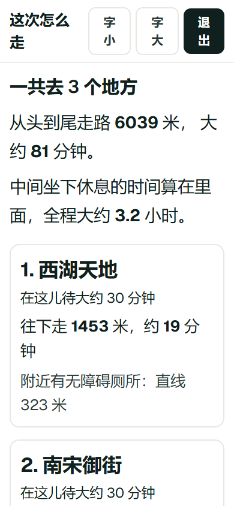

# 参赛投稿正文

团队：未竟工作室。下方按官方 GitHub Issue 模板组织，正文从「参赛项目名称」开始复制。
公开体验入口 [travel.peiqirui.com](http://travel.peiqirui.com/) 目前仍是 2026-10-24 的旧版本（`c906649`），本文描述的新版本尚未部署；部署后更新此行。演示视频暂无，不填虚构链接。
官方入口、截止时间和证据状态见 [EVIDENCE.md](EVIDENCE.md)。

## 投稿标题（填写到 Issue 标题栏）

【2026飞猪AI旅行创新大赛】徐霞客 AI｜带爸妈出游：把「走得动多久」摊开写清楚，想改就改，改了不再花钱

---

## 参赛项目名称

**徐霞客 AI · 带爸妈出游的杭州半日路线**

> 把爸妈走不走得动这件事摊开写清楚，想改哪里就改哪里，改了不再花钱。

孩子想带爸妈多看几个地方，爸妈嘴上说「都行」，其实走半小时就想坐下歇。
徐霞客 AI 只问一件事：爸妈全程一共能走多久。可以点选，也可以说一句「我妈膝盖不好」，系统追问清楚，不替你猜。
然后用飞猪真实地点和高德逐段实测的步行时间排出一条走得完的路线，并写清是哪条条件删掉了哪个站。

## 团队 / 作者与奖品领取人

- 团队名称：未竟工作室
- 主要提交人 GitHub ID（仅 1 位，必填）：[mckinstryhancher688-pixel](https://github.com/mckinstryhancher688-pixel)
- 其他成员（可选，仅用于署名）：本次未登记其他署名

## 旅行场景与目标用户

面向**带父母或祖辈出游的成年子女**，目的地已经定好，但长辈体力跟不上。

这个矛盾不是信息不够，是体力不够：再生成一版攻略解决不了它。
子女心里有数（「我妈走半小时就累」），但这个数没人问过，也没人拿它去算路线。
我们只把一件事变成能算的条件：**爸妈全程一共能走多久（分钟）**，并用高德逐段实测的步行时间判断可行性；
条件满足不了时，明确说清是哪一条把站点压掉了、放宽到多少就能排出。

我们从**杭州半日出游**切入。范围刻意压得很窄：只有杭州、只有半日、只做目的地探索。

## 我做了什么

### 一次真实运行（2026-11-18）

首页选「1 小时」，点「生成我的路线」。飞猪给出「文创街区」候选，高德逐段实测后的完整路线是
西湖天地 → 南宋御街 → 馒头山社区居委会，步行 81 分钟。之后在同一份已实测路段上改条件：

- 全程 1 小时：排 2 站，步行 43 分钟；
- 全程 30 分钟：排不出（只够 1 站），界面写明「放宽到 43 分钟可以排 2 站」；
- 全程 1.5 小时：3 站，合计 81 + 3 × 30 + 20 = 191 分钟；
- 再把每站停留改成 60 分钟：只剩 2 站，并说明是停留时长把第 3 站压掉了。

整场 37 次高德调用、1 次飞猪查询，全部发生在那一次核验里；之后 6 次改条件**新增 0 次**
（[证据](../evidence/family-real-accept.json)，38/38 通过）。
这是一次运行记录，不保证下一次查询返回相同站点或数字。高德步行时间是路径规划的预计值，不是真人走一遍；
每站停留与 20 分钟缓冲是产品设定。

### 三个核心机制

1. **只有一条条件，单位是分钟。** 问「爸妈全程一共能走多久」，判断直接用高德实测的每段步行分钟相加，不先假设步速再换成米。
2. **模糊的话追问，不猜数字。** 「膝盖不好」「走半小时就得歇」「个把小时吧」都会追问「全程一共大概能走多久」，给固定选项让用户点。
   模型只分类、写追问；分钟数由代码从用户原话里算出来，原话里没有确定的全程时长，就不会出现任何数字。
3. **每次取舍都说清原因，改条件不再花钱。** 排不出时写明是哪条条件卡住、放宽到多少能排出；核验付费一次之后，
   改分钟数、改每站停留都是本地重算，界面显示「本次重解新增高德调用：0 次」。

每张行程卡还标出离这一站最近的**高德标注无障碍洗手间**（直线距离）；「给爸妈看」是只讲去哪、走多久、厕所在哪的大字版。

当前版本通过 **459 项离线检查/场景**（16 个套件，全部夹具与请求桩）和零付费浏览器回归；
真实服务证据与模拟证据分别列在[证据索引](EVIDENCE.md)。

### 从发现到规划，再到执行

飞猪 FlyAI 提供候选地点 → 高德核对地点身份与真实步行路径 → 用户说出（或点选）爸妈全程能走多久 → 服务端在已实测路段上求解 →
展示行程、账单（步行 + 停留 + 缓冲）与每条条件的取舍原因 → 到站后点「我到了」听讲解。

当前核心是带长辈的杭州半日安排。长期希望验证的价值是：让子女更容易判断「这条路线爸妈是否真的走得完」。用户留存、支付意愿和商业模式仍需后续验证。

## 百炼使用说明（必填）

- **百炼能力 / 模型：**
  - 读一句话：百炼 OpenAI 兼容接口，模型 `qwen-flash`，强制 JSON 输出、关闭思考模式、temperature 0。
  - 到站讲解：阿里云百炼 Managed Agent（托管智能体）。底层模型以实际百炼部署配置为准。
- **调用方式：**网站服务端调用，属于产品运行时链路；浏览器拿不到任何百炼凭据。
- **使用环节与输入输出：**
  - 读一句话：输入子女描述爸妈体力的一句话，输出类别（给了全程时长 / 需要追问 / 没讲走路）和一句追问。
    **模型不输出任何数字**：分钟数由代码从用户原话里那一段算出，那一段必须逐字出现在原文里；追问里出现用户没说过的时长或距离，整句作废。
  - 到站讲解：输入当前已核验路线与站点事实，输出讲解文本；文本里的「米／分钟」逐条与高德实测值对账。
- **当前实测状态：**读一句话用 40 句真实口语跑过一次（百炼 40 次）：硬性要求（引文是原话、不编数字、一口气不算全程）40/40，
  类别与预期一致 34/40（[证据](../evidence/understand-real-probe.json)）。真实数据下的亲情主流程已端到端验收（见上节）。
- **Skill 名称（如有）：**飞猪数据侧通过官方 FlyAI CLI 获取 POI，不将上游能力宣称为自研 Skill。
- **其他工具 / 技术栈：**Next.js 16、React 19、TypeScript、Tailwind CSS、高德地图 Web 服务及 JS 地图。

## 效果展示

### 1. 真实核验后的路线（高德真实底图）

### 2. 改分钟数、改每站停留，当场重排且不花钱

「调整」页只有两组按钮：全程能走多久（30 分钟 / 1 小时 / 1.5 小时 / 不确定）和每站停留（15 / 30 / 45 / 60 分钟）。
每次都回显一句人话和一行账单，并写清本次新增高德调用次数。

### 3. 给爸妈看的大字版

更多运行截图与验收资料见仓库 [evidence 目录](https://github.com/mckinstryhancher688-pixel/xuxiake-ai-hangzhou/tree/main/evidence)。

**边界（必须与正文一并阅读）**：本项目**不提供坡度、台阶、盲道等路面无障碍数据**（高德公开分类体系中没有），因此**不承诺整条路线轮椅可通行**；无障碍洗手间只是高德 POI 标注点。

## 项目链接与复现方式

- GitHub：[徐霞客 AI 源码仓库](https://github.com/mckinstryhancher688-pixel/xuxiake-ai-hangzhou)
- 运行与配置：[README](https://github.com/mckinstryhancher688-pixel/xuxiake-ai-hangzhou/blob/main/README.md)
- 代码许可证：MIT。飞猪、高德、百炼服务与数据仍受各自条款约束。
- 在线体验：[travel.peiqirui.com](http://travel.peiqirui.com/)，目前仍是旧版本，新版本部署后更新。
- 当前展示方式：开源代码、真实运行截图与证据 JSON、离线及本地模拟验收资料；演示视频暂无。

体验步骤：

1. 按 README 准备运行环境、FlyAI CLI 及自己的服务凭据，在本地启动网页，用 `http://127.0.0.1:3000` 打开。首次真实核验会使用对应服务配额。
2. 首页回答「爸妈全程一共能走多久」：点一个选项，或者在输入框里说一句「我妈膝盖不好」，看系统怎么追问。
3. 点「生成我的路线」，生成杭州半日路线。
4. 到「调整」页改分钟数、改每站停留，观察行程、账单、取舍说明，以及本次新增高德调用次数。
5. 点「给爸妈看」打开大字版；展开行程卡看每段实测距离与最近的无障碍洗手间标注。

边界：步行量统计起点至最后一站的已核验路段，不含回程和景区内部步行；停留时长与缓冲为产品设定；当前不提供完整门票预算或到达时营业保证。**不提供坡度、台阶、盲道等路面无障碍数据，不承诺整条路线轮椅可通行。**

## 踩坑记录（可选）

- **条件越多，越没人填。** 早期我们露出了总步行和单段两条米数条件，档位上的数字还是按路线长度推算的——那等于替用户编了数字。最后只留一条，单位改成爸妈能感受到的分钟，选项是固定菜单加一个「不确定」。
- **模型最容易出错的地方是「一口气」和「全程」。** 「走半小时就得歇」说的是一次走多久，不是全程。我们在提示词里写明了，又在代码里按小句再拦一道，不靠模型自觉。
- **不让模型出数字。** 模型只摘原话、分类、写追问；分钟数由代码从原话里算，算不出就追问。这样界面上显示的数字永远是用户自己说过的。
- **不能每改一次意见就从头请求地图服务。** 将实测事实与路线求解分开，在有效数据范围内本地重算；缺少数据时如实说明，不自动补测。
- **删掉自己的功能。** 「少走一点」让智能体另给一条路线，不遵守用户定的条件，和「条件可见、可改」的定位冲突，所以删了。
- **不能把「点」说成「路」。** 高德只有无障碍洗手间这个 POI 标注点，没有路面无障碍数据；把点讲成整条路线无障碍就是编造。
