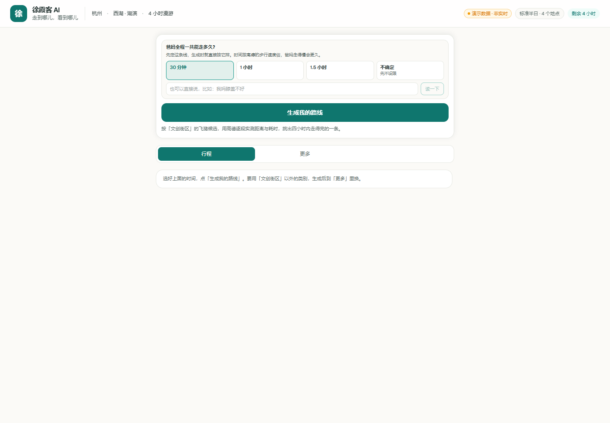

# 参赛投稿正文

团队：未竟工作室。下方按官方 GitHub Issue 模板组织，正文从「参赛项目名称」开始复制。
公开体验入口已于 2026-10-24 发布新修复版本，页面与快照恢复检查通过；真实新版本业务闭环尚待验收。演示视频暂无，不填虚构链接。
官方入口、截止时间和证据状态见 [EVIDENCE.md](EVIDENCE.md)。

## 投稿标题（填写到 Issue 标题栏）

【2026飞猪AI旅行创新大赛】徐霞客 AI｜让「我想带爸妈多逛」和「他们真的走不动」，谈拢成一条走得完的路线

以下正文已改为亲情场景定位。历史双人协商机制仍保留在代码中但不再作为主入口。

---

## 参赛项目名称

**徐霞客 AI · 带爸妈出行的路线协商助手**

> 让「我想带爸妈多逛几个地方」和「他们真的走不动」，变成一条双方都点头的真实路线。

一个想带爸妈多看几个地方，爸妈嘴上说「都行」，其实走两百米就想歇一会儿。
徐霞客 AI 把「走不动」变成能算的条件——一天最多走多远、一口气最长走多长——
用飞猪真实地点和高德逐段实测的距离排出一条真的走得完的路线，并告诉子女是哪个限制删掉了哪个站。

## 团队 / 作者与奖品领取人

- 团队名称：未竟工作室
- 主要提交人 GitHub ID（仅 1 位，必填）：[mckinstryhancher688-pixel](https://github.com/mckinstryhancher688-pixel)
- 其他成员（可选，仅用于署名）：本次未登记其他署名

## 旅行场景与目标用户

面向**带父母或祖辈出游的成年子女**，目的地已经定好，但长辈体力跟不上。

这个矛盾不是信息不够，是体力不够：直接再生成一版攻略解决不了它。
有人想多逛几个地方，长辈走两百米就想坐；有人特别想去一个景点，家人只是陪着。
我们把「走不动」拆成两个能算的硬条件——**全天总步行上限**与**单段最长连续步行上限**——
并基于高德逐段实测的真实距离判断可行性，条件满足不了时明确说清是哪一条把站点压掉了。

我们从**杭州半日出游**切入。范围刻意压得很窄：只有杭州、只有半日、只做目的地探索。

## 我做了什么

### 一次具体取舍，看得见改变

仓库的一次实际运行中，初版路线为 **7.50 公里、步行 100 分钟**。同伴将步行上限设为 **约 5 公里（本次输入 5001 米）**后，重新求解得到 **3.77 公里、步行 50 分钟**的方案：保留“平湖秋月”和“三潭印月”，删去“满陇桂雨”，总行程从 **210 分钟变为 130 分钟**。

这些是该次运行的结果，不是对所有路线的承诺。步行距离与预计耗时来自高德路径规划，不是实地走测；总行程包含每站 30 分钟停留和 20 分钟缓冲的产品设定。

### 三个核心机制

1. **「走不动」是能算的，而且是两个独立条件。** 一个是全天总步行上限，一个是**单段最长连续步行上限**——总量够短但中间有一段走不动，同样判为不可行。服务端按高德逐段实测值判断，不替用户放宽。
2. **每次取舍都说得清是谁的哪条限制造成的。** 排不出时不是只说「站太少」，而是「取消单段上限后能排到 4 站，说明是『一口气最多走 400 米』把站点压掉了」。每张行程卡还标出**离这一站最近的高德标注无障碍洗手间（直线距离）**。
3. **改主意不再花钱。** 核验付费一次、把实测路段留在事实层之后，改上限是本地重解、**0 新增高德调用**；界面直接显示本次新增调用次数。

当前版本已通过 **421 项离线检查/场景**（16 个套件，含来源证据 20 项、单人重解 64 项、无障碍洗手间 17 项、`/api/resolve` 步行分钟口径 21 项、「读一句话」53 项五套专项），以及零付费浏览器回归。真实服务证据与模拟证据分别列在[证据索引](EVIDENCE.md)。

**成本与边界的实测记录**：一次真实核验用 27 次高德调用，之后连续三次修改步行上限，新增调用为 **0 / 0 / 0**（[证据](../evidence/solo-resolve-accept.json)）。

### 从发现到规划，再到执行

飞猪 FlyAI 提供候选地点 → 高德核对地点身份与真实步行路径 → 用户设定总步行与单段上限 → 服务端在已实测路段上求解 → 展示行程与每条限制的取舍原因。

百炼在运行时提供现场讲解与受约束的减法建议；解释接口也已接入。真实回合状态单独列在下节。

当前核心是带长辈的杭州半日安排。长期希望验证的价值是：让子女更容易判断「这条路线爸妈是否真的走得完」。用户留存、支付意愿和商业模式仍需后续验证。

## 百炼使用说明（必填）

- **百炼能力 / 模型：**阿里云百炼 Managed Agent（托管智能体）。底层模型以实际百炼部署配置为准，不将仓库没有固定公开的型号写成既成事实。
- **调用方式：**网站服务端通过百炼 Managed Agent HTTP API 管理会话并执行回合，属于产品运行时链路。
- **使用环节与输入输出：**
  - 现场讲解：输入当前已核验路线与站点事实，输出讲解文本。
  - “少走一点”：输入当前路线与事实，输出减法建议；服务端复核后才允许采用。
  - 解释取舍：接口已接入服务端事实块，包括条件、冲突证据、实测路段、候选排除原因及允许的下一步；模型负责解释和提出受约束建议，不能改写硬条件或路线数字。
- **当前实测状态：**已有单人讲解与路线调整的真实运行证据；解释链路的事实构造、角色隔离与失败处理已通过离线测试。**真实数据下的完整亲情流程尚未端到端验收**，公开版本如实标注这一点，不将测试桩结果当作真实模型效果。
- **Skill 名称（如有）：**飞猪数据侧通过官方 FlyAI CLI 获取 POI，不将上游能力宣称为自研 Skill。
- **其他工具 / 技术栈：**Next.js 16、React 19、TypeScript、Tailwind CSS、高德地图 Web 服务及 JS 地图。

## 效果展示

### 1. 改「爸妈能走多远」，当场重排且不花钱

界面两块选择器：全天总步行与单段最长连续步行。改完立刻回显「全天走 X 米，在您定的 Y 米以内；最长一段 Z 米」，并写清本次新增高德调用次数。

### 2. 每站标注最近的高德无障碍洗手间

只写高德真实标注的点与**直线距离**，并明确标注「不代表整条路线无障碍、不代表当天开放」。

更多运行截图与验收资料见仓库 [evidence 目录](https://github.com/mckinstryhancher688-pixel/xuxiake-ai-hangzhou/tree/main/evidence)。

**边界（必须与正文一并阅读）**：本项目**不提供坡度、台阶、盲道等路面无障碍数据**（高德公开分类体系中没有），因此**不承诺整条路线轮椅可通行**；无障碍洗手间只是高德 POI 标注点。

## 项目链接与复现方式

- GitHub：[徐霞客 AI 源码仓库](https://github.com/mckinstryhancher688-pixel/xuxiake-ai-hangzhou)
- 运行与配置：[README](https://github.com/mckinstryhancher688-pixel/xuxiake-ai-hangzhou/blob/main/README.md)
- 代码许可证：MIT。飞猪、高德、百炼服务与数据仍受各自条款约束。
- 在线体验：[travel.peiqirui.com](http://travel.peiqirui.com/)，2026-10-24 已检查首页可达，新版本发布与真实闭环验收状态见证据索引。
- 当前展示方式：开源代码、历史真实运行截图、离线及本地模拟验收资料；演示视频暂无。

体验步骤：

1. 按 README 准备运行环境、FlyAI CLI 及自己的服务凭据，在本地启动网页。首次真实发现和核验会使用对应服务配额。
2. 在「生成我的路线」上方先选「爸妈大概能走多远」，再生成杭州半日路线。
3. 路线出来后，随时改「爸妈能走多远」或「一口气最多走多远」，观察行程与取舍说明如何变化，以及本次新增高德调用次数。
4. 展开行程卡看每段实测距离与最近的无障碍洗手间标注。

边界：步行量统计起点至最后一站的已核验路段，不含回程和景区内部步行；单段上限按两站之间最长的一段判断；停留时长与缓冲为产品设定；当前不提供完整门票预算或到达时营业保证。**不提供坡度、台阶、盲道等路面无障碍数据，不承诺整条路线轮椅可通行。**

## 踩坑记录（可选）

- **「走不动」不是一个条件，是两个。** 只限总量会漏掉「中间有一段连着走 1.2 公里」的情况，所以单段上限必须独立判定。
- **不能让用户不知道为什么被删站。** 只说「站太少」等于没说；必须指出是哪条限制造成的，并给出经枚举验证的建议值。
- **不能每改一次意见就从头请求地图服务。** 将实测事实与路线求解分开，在有效数据范围内本地重算；缺少数据时如实说明并要求批准补测。
- **不能让 AI 用漂亮文字掩盖冲突。** 距离、时间、可行性由规则与真实工具结果确定；模型失败时如实展示，不用固定文案冒充模型返回。
- **不能把「点」说成「路」。** 高德只有无障碍洗手间这个 POI 标注点，没有路面无障碍数据；把点讲成整条路线无障碍就是编造。
