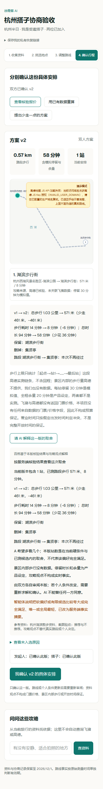

# 旅行空间实施与验收记录 · 2026-11-01

旅行空间、随时邀请、资料整理、混合检索和真实路线协商已在本地生产构建中实现并验证。新入口默认关闭，尚未发布到生产，也没有完成外部用户试用。

## 已交付

- SQLite保存空间、角色、邀请、资料、任务、索引、路段证据和调用账本；重启后恢复，空间保留30天，路线事实按原采集时间六小时失效。
- A可以先单人使用；邀请预览不加入，B明确加入后原个人执行权限失效。双方独立提交底线并确认同一revision与内容身份。
- 文字与限量截图整理，保留原文、原图和初次识别文字；纠错替换索引，删除资料清除内容、索引及图片，保留已采用路线与删除标记。
- BM25、中文分词、地点别名、512维真实向量与RRF混合检索，回答可展开原文／原图；无依据明确回答，语义失败明确降级。
- 显式飞猪分类补充、报价后高德核验。新地点不伪造飞猪ID；跨平台身份采用旧核验规则，身份不清需要本人确认。
- 双方偏好进入六候选范围与原双人求解器，保留四小时、四站与地点范围限制。无解时保存冲突证据，不能用旧确认继续执行。
- 已测路段持久复用，部分失败保留成功结果；费用额度、幂等和重启结果未知处理不会依赖单次内存。
- 独立的关闭工具的百炼资料会话与协商解释；不把攻略数字加入路线白名单，解释不符合事实口径时明确退回服务端摘要。

实现与开关说明见[TRAVEL-WORKSPACE.md](TRAVEL-WORKSPACE.md)。旧单人／双人入口、快照和历史内容哈希保持兼容；没有更改现有服务凭证或Managed Agent配置。

## 自动验收

| 检查 | 结果 | 证据范围 |
| --- | --- | --- |
| npm run test:trips | 53/53，fetch=0 | 临时SQLite与人工夹具；不是高德真实调用 |
| npm run test:offline | 原套件全部通过 | 既有求解、守卫、持久化、地图与版本回归 |
| TypeScript、ESLint | 通过 | 显式类型检查及最终生产构建类型检查；Lint无警告 |
| npm run build | 通过 | Next.js 16.4.2、本机Node 24.20.0 |
| 真实向量评测 | 前六召回19/20，门槛18/20 | 10段人工资料、20个人工标注问题；不是总体用户准确率 |

保留了一条失败问题：“不喜欢嘈杂拥挤，有什么建议？”没有在前六召回指定的“安静”依据。相关避坑段虽然被召回，仍按原标注记为失败，没有修改标注提高分数。见[完整评测](../evidence/trips-rag-evaluation-2026-11-01.json)。

## 双浏览器真实业务验收

两个独立Chromium会话分别操作A、B，使用本地生产服务。操作由开发代理完成，不等于两位外部用户试用。

1. A创建空间、分享邀请，B预览时未加入，明确接受后加入。
2. A上传文字、B上传截图。资料是人工编写的测试夹具；文字提取、截图识别、512维向量化使用真实百炼调用。
3. “原作者不推荐周末午后拥挤时前往”被保存为原文提醒，没有被当作B本人的绝不接受。
4. 集贤亭存在多个高德结果，A选择实际返回的地点身份；两个攻略地点未关联飞猪数据，使用高德独立身份与有向路段核验。
5. B初始上限6000米。真实首版仅1032米，并未超限，没有为了演示虚构六公里冲突。
6. 将B测试上限改为800米，系统复用已有事实删去集贤亭，产生v2；A原v1确认失效，A、B各自确认v2。

| 指标 | v1 | v2 |
| --- | --- | --- |
| 景点 | 湖滨步行街、集贤亭 | 湖滨步行街 |
| 高德规划步行 | 1032米 | 571米 |
| 高德预计步行耗时 | 14分钟 | 8分钟 |
| 含设定停留／余量的总时长 | 94分钟 | 58分钟 |
| 调整新增高德请求 | — | 0 |
| 最终确认 | A曾确认此版 | A、B分别确认同版 |

本空间共记录3次高德地点HTTP请求、4次步行HTTP请求；一次飞猪分类补充返回10个候选，未修改已确认v2。原有折线点数与SHA256记录在[脱敏真实证据](../evidence/trips-live-2026-11-01.json)中。

## 问答与解释观察

- “哪份攻略不推荐周末午后前往湖滨步行街？”真实问答引用正确的截图标题、段落与原图。修复了早期只回答内部片段ID的问题。
- “木星酒店今晚还有几间可订房？”明确回答资料没有依据，没有自动外搜。
- 资料问答和协商解释没有增加飞猪／高德调用。
- 一次真实协商解释使用了正确距离，但夸大了软偏好满足程度。最终拦截器拒绝该说明，界面明确显示服务端摘要与原因。此项证明防护生效，不宣称模型解释质量已经稳定。
- 本地高德JS SDK返回INVALID_USER_DOMAIN（10006）。实际路段数据仍在，界面明确退回示意底图，没有用直线伪造道路折线。没有修改Key或域名配置。

## 尚未完成的发布条件

- 当前没有可用的服务器SSH凭据或Workbench控制通道，未更新线上容器。
- Dockerfile已固定Node 24.20.0，因本机Docker守护进程未运行，容器构建和生产卷写权限尚未验证。
- 需在实际域名验证HTTPS、地图JS域名授权、持久化卷、备份恢复及一次双浏览器流程。发布顺序见[上线操作说明](WORKSPACE-RELEASE.md)。
- 尚未组织三至五组外部搭子试用；模型解释质量、手机长页面体验和无答案问题仍应在试用阶段重点观察。
- 没有录制新演示视频或将新能力描述为已经在线开放。

本轮生成的数据库、私有恢复链接、邀请凭据、模型密钥和原始SDK响应未纳入Git提交。

