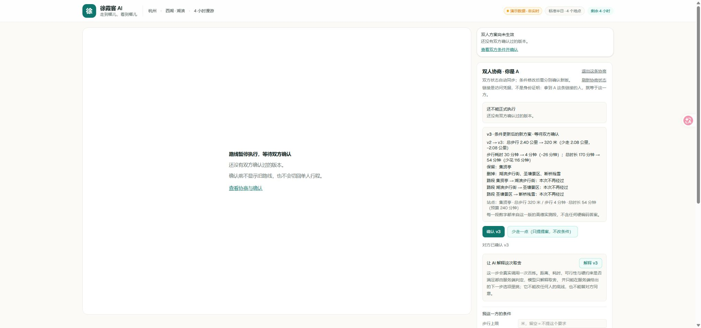
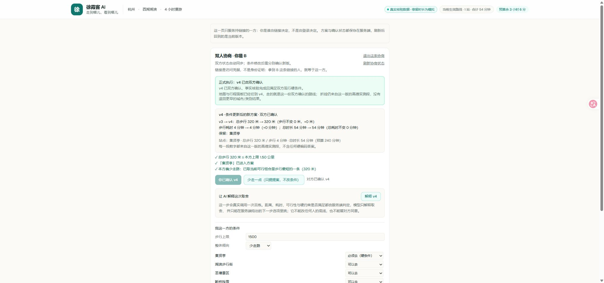

# 双人协商可靠性修复与交接（2026-10-23）

基线：`3e129045659dd8c13ec92e66077ce92a4650c5c3`。修复分支：`codex/negotiation-reliability`。

本轮处理线上手工测试已定位的表单、同步、退出、解释和补测批准问题。没有改真实 API 配置、安装依赖、合并 main、推送或部署。真实 POI 身份、路段数值和求解排序保持原有逻辑。

## 完成的修复

| 问题 | 修复后的行为 |
|---|---|
| 选项回跳、显示与提交不一致 | 所有 POI 选项读写同一份草稿，增加每个地点的可访问名称 |
| 刷新后底线清空，只改软偏好会删除硬约束 | 完整回填本方条件；步行上限、必须去、绝不接受、软偏好和未显示的结束时间均保留 |
| 同伴更新、页面仍是旧版 | 可见页每 3 秒 GET，聚焦时同步；提供手动刷新和版本变化提示，轮询不调用付费工具 |
| 自动同步覆盖未提交内容 | 保留草稿；若本方条件被另一页面修改，阻止覆盖并提示加载最新条件；有草稿时不能误确认未包含该草稿的方案 |
| 旧正式路线在条件变化后仍显示/可操作 | 待确认、保存中或同步失败时暂停路线与单人动作；双人正式路线直接读服务端 official，不能回退单人 adjustment |
| 邀请页退出后自动重入、刷新误报缺失 hash | 退出使旧请求和 seed 失效；完整新链接优先；同 plan 的有效 session 可恢复；支持新 hash 链接和开发模式 effect 重放 |
| 有实测连接却解释为缺边 | 排除自环干扰，只按当前路线相关有向段及已有可行组合说明原因 |
| 未填写被当成无异议 | AI 输入明确区分未设置、未评价与显式“可以去”，说明不能推断满意或同意 |
| 条件失败未升版，旧 AI 解释仍显得有效 | 条件、版本、确认及事实上下文变化后失效旧解释；旧在途回包不能复活；服务端在调用百炼前拒绝暂停/待补测的旧版本解释 |
| 旧补测报价批准了新条件 | 报价绑定双方条件和版本；前端失效提示，服务端锁内再次核对。缺失/过期指纹在改条件、补测之前被拒绝 |
| 提交按钮承诺不新增调用，实际可能补测 | 改为“提交我的条件”，明确优先复用、缺段可能自动补测、超过当前阈值先询问 |

## 验证结果

全部使用夹具、假密钥或阻断外部 fetch 的测试进程。以下数字不构成真实高德路线或真实百炼输出的验收。

- `npm run test:offline`：**159/159**。分别为协商 76、状态规则 22、AI 边界 29、持久化 25、条件编辑 7。
- `npm run lint`：通过，无警告。
- 默认 `next build`（Turbopack，含 TypeScript 检查）：通过。
- 浏览器手工回归：**18/18**（开发模式 9 项，生产构建及最终冒烟 9 项）。详见 [交互结果 JSON](../evidence/negotiation-reliability-ui.json)。
- 生产模式验证了：同伴更新自动同步、刷新保留底线、未提交草稿禁止确认、仅一方确认时隐藏旧路线、双方同版确认后切到新行程、确认后再改底线会自动挂起旧路线。
- 最终本地服务端记录：地点查询 0、步行查询 0、协商逻辑请求 0、HTTP 重试 0。

依赖来自本机原已安装版本，独立工作区用硬链接复用；没有改依赖版本、锁文件或 Next 配置。最初 node_modules junction 不被 Turbopack 根目录接受，改为硬链接副本后完成默认构建，未把这种本机处理写入生产代码。

### 本地夹具截图

下面是模拟数据验收画面，**不是线上真实路线的证明**。界面沿用产品的数据标签，地点和距离均来自 `negotiation-fixture.ts`。

## 尚未处理与验收边界

1. 默认自然风光候选过远、首访生成失败的问题尚未改。这需要另行调整发现范围和失败恢复，不能通过伪造路线或放宽预算解决。
2. 假定出发时间与杭州时区显示不一致、切换类别后旧核验结果的标记，以及 B 页路线查看体验，尚未纳入本轮。
3. 本轮改正 AI 的输入事实与请求门禁；没有证明模型永远不会出现态度推断或其他非数值措辞错误。真实百炼输出仍需后续受控回归。
4. 已保存的历史 disposition 和旧解释不会自动改写，应复用已有事实生成新版本。不要把修复前的解释当作修复后结果。
5. 没有进行物理双手机测试，也没有用浏览器网络延迟注入逐一重现所有请求乱序；这部分做了作用域、取消和序号防护及独立代码审查。
6. 本轮没有重跑线上付费验收，因此不能声称原有真实路线验收已在本分支重新通过。

## 合并和上线

- 本分支可以独立合并；参赛材料在另一分支 `codex/submission-packaging`，本轮没有修改其 README/DEMO 文档。
- 成本批准新增 `expectedCostKey`：前后端应同批发布。升级前打开的旧页面在批准补测时会被安全拒绝，需刷新后重新报价。条件和事实快照的持久化 schema 没变。
- 发布前保留线上原快照与回滚版本；发布后安排一次受控的真实闭环：真实路线 → B 收紧底线 → A 查看变化 → 双方分别确认 → B 再改条件 → 两边旧路线立即挂起。已有事实足够时应复用，不再冷核验。
- 本轮保留了原求解目标、真实身份核验、实测有向段、补测硬上限、版本号和内容哈希、双人确认与持久化守卫。

本机详细日志及截图另存于 `D:\Driver\OneDrive\ドキュメント\ChatGPT\飞猪\修复验收-20261023`；handoff.json 内的本地测试角色凭据未加入 Git。
