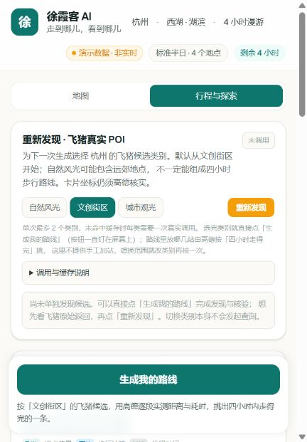

# 2026-10-24 生产发布记录

公开入口：[travel.peiqirui.com](http://travel.peiqirui.com/)。前后端同批发布，运行代码为 `c906649bbdd80bfd393ebe99d55ac8e6b4fe4259`。
该提交包括两轮可靠性修复、README、投稿正文、演示手册、证据索引和答辩材料；后续发布状态勘误只更新文档与证据。

## 构建与发布

- 258 个离线检查/场景于 2026-10-24 重新运行通过，生产构建通过；浏览器夹具检查记录仍单独标注为本地测试。
- [发布附件](https://github.com/mckinstryhancher688-pixel/xuxiake-ai-hangzhou/releases/tag/release-20261024-c906649)：`xuxiake-c906649.tar.gz`，2,488,652 字节。
- SHA256：`b957e8bfe8fe8a63e72490b3d9c357e4b4f41d5cc8b8622df67ed81ecb4e3678`；服务器下载后校验通过。
- Next Build ID：`azpwDSqhVqw1g8u6H2kpb`；运行容器标签与 Build ID 均已核对。
- 复用旧镜像的生产依赖；新旧锁文件解析后的 JSON 一致，无依赖安装。附件不含环境变量、行程快照、角色凭据或 node_modules。
- 先在备用端口以只读快照挂载检查，再切换正式应用；Nginx 配置检查与重载通过。

## 线上只读验证

- 域名首页 HTTP 200，新默认「文创街区」与提示生效，实际浏览器可切换「地图 / 行程与探索」。
- 首页引用的 10 个静态资源均返回 200，见[检查记录](../evidence/release-2026-10-24.json)；该次页面无浏览器 warning/error。
- `/api/plan` 返回 200，`persist.restored.status = loaded`，恢复 1 份协商快照；无损坏或过期方案被跳过。
- 既有快照为 435,839 字节，发布前后内容一致；服务配置与 Nginx 配置也逐字一致，新旧容器运行环境比较一致，未变更百炼、飞猪或高德配置。
- 数据卷仍为 `xuxiake-data → /app/.data`，正式容器可写；应用保留原网络和 `unless-stopped` 重启策略。
- 只读检查后的高德地点/步行计数均为 0。未点击发现、真实核验或百炼操作；过期事实没有被续期或自动冷重测。

## 保留的回退点

旧应用容器 `xuxiake-app-rollback-20261024` 已停止并保留，旧镜像 `xuxiake-app:rollback-20261024-c906649` 也已保留。
原配置及快照在服务器上另有私有备份；没有清理数据卷或替换历史真实验收证据。

## 仍待完成

本次证明发布及只读页面/恢复检查通过，不能证明新的真实路线、双人完整协商或双人百炼解释已端到端通过。
真实业务复验需另行控制调用次数并留存脱敏证据；演示视频仍未录制，官方参赛 Issue 本轮未代为提交。
旧高德 Key 删除、生产域名白名单与 HTTPS 尚未在本轮设置或复核，不能宣传为已完成。
