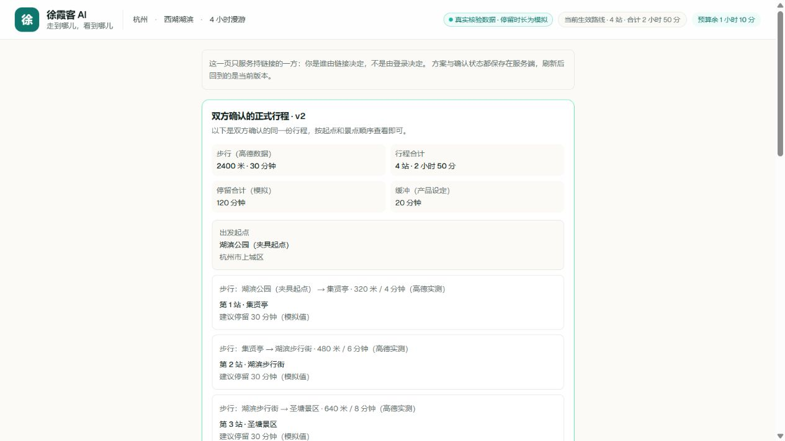
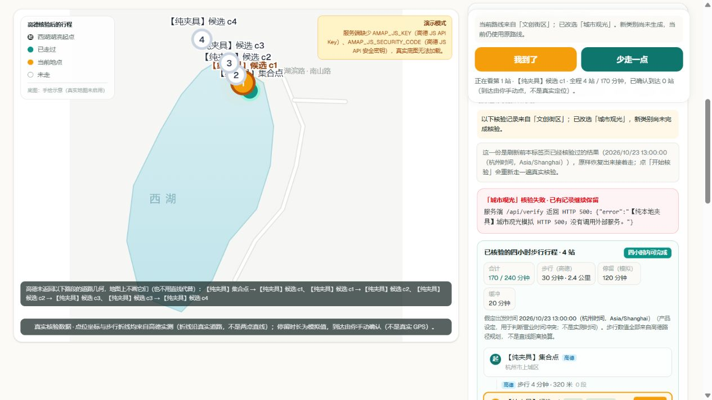

# 路线体验与正式行程：第二轮修复（2026-10-23）

基于第一轮 `0733b9f`，继续在 `codex/negotiation-reliability` 修复。没有合并 main、推送或部署；没有安装依赖、改飞猪/高德/百炼配置或调用真实付费接口。

## 完成的行为

| 问题 | 当前处理 |
|---|---|
| 首访默认自然风光返回远郊候选，可能无四小时路线 | UI 默认单选文创街区。依据此前真实手测的文创成功记录选更适合市内步行的入口；不保证每次都有解。保留 API 未传类别时的原双类别 fallback。 |
| 无解后反复重试可能继续消耗 | 提供“改选文创街区（仅切换类别）”，只改勾选，不自动查询；用户再显式生成。失败重试可能新增请求，撤回“重复点击必定零调用”的承诺。 |
| 改选新类别后，旧候选和路线仍像新结果 | 发现批次、原始核验报告与当前路线分别标明实际来源；出现“上次发现结果”“待按新类别核验”。报告类别从 report 自身读取，不从新请求勾选反推。 |
| 新查询异常清掉已有结果或迟到结果覆盖当前页 | HTTP 异常保留本城市已知报告，单独记录失败查询类别；城市作用域与请求序号拒绝旧响应写回。合法的无解报告仍如实替换本轮结果。 |
| 服务端时区导致假定 13 点出发显示成 21 点 | 出游日期与展示均明确使用 Asia/Shanghai；13:00 序列化为 05:00Z，四小时结束为 17:00。双人求解的结束上限使用相同口径。 |
| 无解一概解释成全部超时 | 对具备完整实测有向段的组合与缺段组合分别计数。真正超时时显示最短完整总时长，不把反向路段、HTTP 请求耗时或估算步行作为证据。 |
| B 方确认后只能看协商摘要 | 新增正式行程卡片：起点、景点顺序、逐段米/分钟、模拟停留、缓冲和不含回程边界，直接复用服务端 official。 |
| B 回主界面可能恢复此前 A 的页面状态 | 两个返回入口使用同标签整页载入，重新恢复当前角色；避开 Next Cache Components / Activity 对旧页面 state 的保留。没有新开身份标签页。 |
| B 没有单人 VerifyReport 时，正式路线面板为空或误说 Mock | 正式行程展示独立于单人原始报告，来源读本次协商 facts；不展示冷核验入口，不以默认勾选类别冒充正式版本来源。 |
| 打开已确认地图因缺折线而隐式请求高德 | 双人模式带角色凭据和正式版本号，只读服务端当前正式路线保存的折线；缺失就不画。旧版本、错误凭据与非法坐标都不进入单人补查分支。单人旧的按需补查行为保留。 |
| 事实过期后 UI 仍宣称可以正式执行 | 页面快照、正式执行与 AI 事实入口共用原始 measuredAt＋现有六小时 TTL。轮询不能续期；过期明确阻止执行，不改历史确认、不自动付费重核。 |

真实 POI 身份核验、8 公里候选范围、最近六个 shortlist、单人 3–4 站、240 分钟预算、实测有向路段、最大化站数后最短时间的顺序均保持。只修正原“8 公里之外四小时往返不可能”的过度断言：系统未测这些路段，只能说明超出候选范围。

## 验证与证据

- `npm run test:offline` 通过：协商 76、状态规则 22、AI 边界 29、持久化及过期 34、条件编辑 7、杭州时间 15 个跨日期/三时区场景、正式展示门禁 9、单人选路与归因 11、查询来源与请求作用域 10、前端几何作用域 8、联合只读几何端点 37，共 **258 个离线检查/场景**。
- `npm run lint` 无错误或警告；默认 Turbopack `next build` 和 TypeScript 检查通过。
- 本轮 **17/17 浏览器检查**：开发模式 10，生产构建 5，最后几何修复构建补充 2。覆盖 A→B→主界面身份、无单人报告的正式路线、杭州时间、类别来源、HTTP 500 保留已有报告、修改底线后隐藏正式卡与旧主路线，以及正式地图只读存量几何。
- 另以本地代理计数证明：自然无解后点击“改选文创街区”，仅发生原先那一次核验 POST，没有自动增加发现或核验 POST。
- 最终本地服务端：地点请求 0、步行请求 0、协商逻辑请求 0、HTTP 重试 0。夹具收紧 B 的上限后本地重解为 v3，处于待确认状态。
- 最终生产端点实测（本地夹具）：合法正式版本的缺几何请求返回 200、明确“不补查高德”、`newCalls=0`；旧版本请求返回 409、`newCalls=0`。前端实际打开主界面也读到同样的存量缺失结果。37 项离线端点检查还使用非空假高德 Key 与 fetch 桩证明拒绝路径不会偷偷尝试联网。
- [浏览器结果及计数](../evidence/route-experience-followup-ui.json)。原始日志保存在本机 `D:\Driver\OneDrive\ドキュメント\ChatGPT\飞猪\修复验收-20261023\second`；角色令牌文件没有入库。

浏览器测试进程使用空 key 并阻止对外 fetch。类别测试代理仅在本地运行，返回明确带“纯夹具”名称的模拟数据，禁用百炼并返回空道路几何；没有修改生产端点加入测试开关。以下截图均为**模拟数据验收，不能用作真实路线或真实高德结果的参赛证据**。

## 仍需上线前后完成的工作

1. 将两轮修复作为同一分支审阅、合并并同批发布前后端；本轮没有替用户上线。
2. 发布后做一次受控真实回归：默认文创发现与核验 → 两方独立表态 → 收紧步行上限 → 复用事实重解 → 双方确认 → B 查看正式路线及地图。离线通过不等于本分支已经重过真实路线验收。
3. 现有历史错误时间、排除说明和 AI 解释不自动重写；应复用仍有效的事实生成新 revision，再重新确认。不得直接修改已确认版本的事实或哈希。
4. 自然风光仍可能无解；本轮没有扩大搜索接口、编造附近参数、放宽站数/预算或改变求解目标。失败报告仍不整体缓存，失败重试可能增加调用；不要在演示中连续冷重试。
5. 真实双手机、真实百炼解释和真实底图/道路几何仍需受控验收。本地缺 JS Key 的夹具截图不能证明地图服务已在线恢复。

联合地图的新读取协议也要求前后端同批发布。旧页面仍可能发送不带联合版本号的单人几何请求；上线后先刷新页面，再进入角色链接测试，不要用升级前保留的旧页面证明新门禁。

事实过期的门禁比旧版本更严格：超过原采集时间六小时会暂停执行，即使该数据近期被读取过。已有确认记录会保留，但不再被界面当作当前可执行事实。
